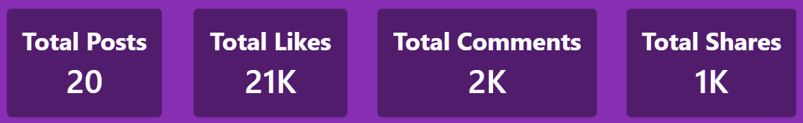
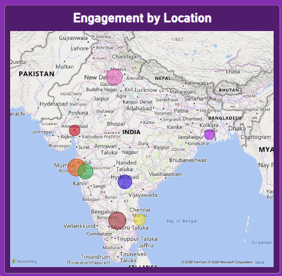
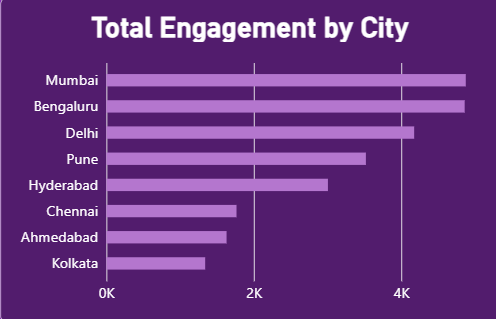
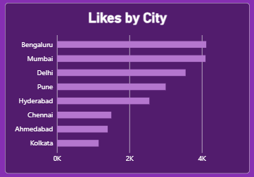
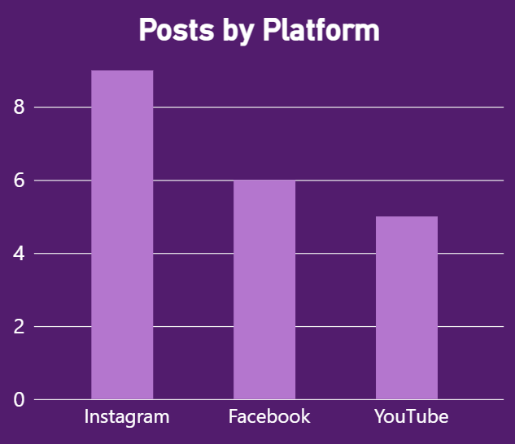
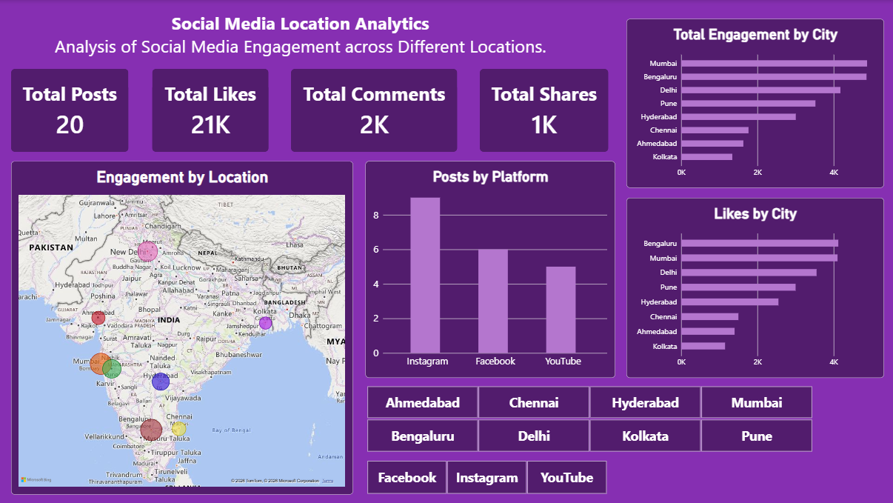

# 📊 SOCIAL MEDIA LOCATION ANALYTICS DASHBOARD

### Using Microsoft Power BI

An interactive Power BI dashboard for analyzing social media engagement across different geographical locations and platforms.

---

## 🎯 1. Aim

To develop an interactive Power BI dashboard for analyzing social media engagement across different geographical locations and platforms.

## 🎯 2. Objectives

- To analyze social media posts based on different cities and countries.
- To compare likes, comments, and shares across different locations.
- To identify differences in overall social media engagement between cities.
- To compare the number of posts across different social media platforms.
- To provide interactive filtering using City and Platform slicers.
- To represent social media engagement geographically using a map visualization.

## 📖 3. Introduction

Location Analytics is the process of analyzing data according to geographical locations. In this project, social media post information is analyzed using Microsoft Power BI to understand how engagement varies across different cities and platforms.

The dashboard uses likes, comments, shares, posts, city, country, and platform information to present the data in an interactive and easy-to-understand form. Power BI visuals such as cards, maps, bar charts, column charts, and slicers are used to support the analysis.

## 📂 4. Dataset

The dataset contains social media post information based on different locations. It includes the following fields:

- Post ID
- City
- Country
- Platform
- Likes
- Comments
- Shares

**Dataset file:** `Location_Analytics.xlsx`

## 🛠️ 5. Tools and Technologies

- Microsoft Power BI Desktop
- Microsoft Excel
- Map Visualization
- Bar and Column Charts
- Card Visuals
- Slicers

## ⚙️ 6. Methodology

1. **Data Import:** The social media dataset was imported from an Excel file into Power BI.
2. **Data Preparation:** The data was loaded into Power BI and the data types of the columns were checked.
3. **KPI Creation:** Card visuals were created to display Total Posts, Total Likes, Total Comments, and Total Shares.
4. **Geographical Analysis:** A map visual was created to display social media engagement across different cities. Hover over a particular city bubble to see the engagement of that city.
5. **Comparative Analysis:** Bar charts were created to compare total engagement by city and likes by city.
6. **Platform Analysis:** A column chart was created to compare the number of posts across platforms.
7. **Interactive Filtering:** City and Platform slicers were added to allow users to filter the dashboard.
8. **Dashboard Design:** The visuals were arranged on a single dashboard page and formatted with suitable titles, headings, and colours.

## 📈 7. Dashboard Visualizations

### 📊 7.1 KPI Cards

Four card visuals provide a quick summary of the dataset:

- **Total Posts:** 20
- **Total Likes:** 21K
- **Total Comments:** 2K
- **Total Shares:** 1K

### 🌍 7.2 Engagement by Location

A map visual shows social media engagement across different cities. Hover over a city bubble to view location-based engagement information.

### 📍 7.3 Total Engagement by City

  

A bar chart compares the overall engagement of different cities and helps identify differences in engagement levels between locations.

### ❤️ 7.4 Likes by City

A bar chart compares the number of likes received by posts from different cities.

### 📱 7.5 Posts by Platform

A column chart compares the number of posts from Instagram, Facebook, and YouTube.

### 🎛️ 7.6 Interactive Slicers

City and Platform slicers make the dashboard interactive. For example, selecting Mumbai in the City slicer filters the dashboard to show the analysis for Mumbai. The same method can be used for other cities and platforms.

**City Slicer**

**Platform Slicer**

### 🖥️ Complete Dashboard

## 🔍 8. Dashboard Analysis

The dashboard combines numerical summaries, geographical information, comparisons, and interactive filters on a single page. This allows the user to move from an overall view of the dataset to a more specific city- or platform-level analysis.

## 💡 9. Observations

1. Social media engagement varies across different cities in the dataset.
2. Mumbai and Bengaluru show relatively high overall engagement in the dataset.
3. Instagram has the highest number of posts among the platforms shown.
4. The map provides a clear geographical view of social media engagement.
5. Likes, comments, and shares help compare user engagement between different locations.
6. The slicers allow users to analyze a particular city or social media platform.

## ✅ 10. Output

The final output is an interactive Power BI dashboard containing KPI cards, a geographical map, city-wise comparison charts, platform-wise analysis, and interactive City and Platform slicers.

## 🏁 11. Conclusion

The Social Media Location Analytics project demonstrates how Power BI can be used to analyze and visualize social media engagement across different geographical locations and platforms. The dashboard brings together total posts, likes, comments, shares, city-wise engagement, likes by city, and platform-wise posts in an interactive format.

The use of map visualization and slicers makes the analysis easier to explore. Overall, the project shows how data visualization can convert social media data into meaningful geographical and platform-based insights.

## 🚀 12. Future Scope

- Include a larger dataset with more cities, countries, and social media posts.
- Add date and time fields to analyze engagement trends over time.
- Include additional social media platforms.
- Add sentiment analysis to study the nature of user responses.
- Use advanced Power BI features such as drill-through pages and detailed tooltips.
- Connect the dashboard to regularly updated data for continuous analysis.

## 📁 14. Project Files

- `Powerbi_project.pbix` — Power BI dashboard file.
- `Location_Analytics.xlsx` — Excel dataset.
- `screenshots/` — Dashboard and visualization screenshots.

## ▶️ How to Use

1. Download or clone this repository.
2. Open `Powerbi_project.pbix` in Microsoft Power BI Desktop.
3. If Power BI asks for the dataset location, connect the report to `Location_Analytics.xlsx` and refresh the data.
4. Use the City and Platform slicers to filter the visuals.
5. Hover over map bubbles and chart elements to inspect the available details.

## 👩‍💻 About Me

**Vanishri Suresh**

B.Sc. Data Science

SIES College of Arts, Science & Commerce

- **LinkedIn:** [Vanishri Suresh](https://www.linkedin.com/in/vanishri-suresh-0a18a4357)
- **GitHub:** [vanishri207](https://github.com/vanishri207)
- **Email:** [vanishrisuresh20@gmail.com](mailto\:vanishrisuresh20@gmail.com)

---

⭐ Thank you for visiting my project repository!

🌟 Feedback & Support

Feel free to share suggestions or compliments — your feedback is appreciated!
If you found this project useful, please consider giving it a ⭐️.
